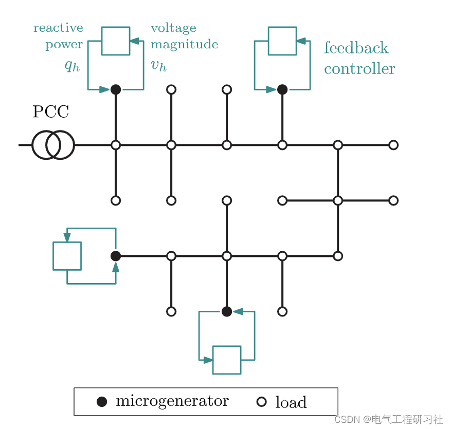
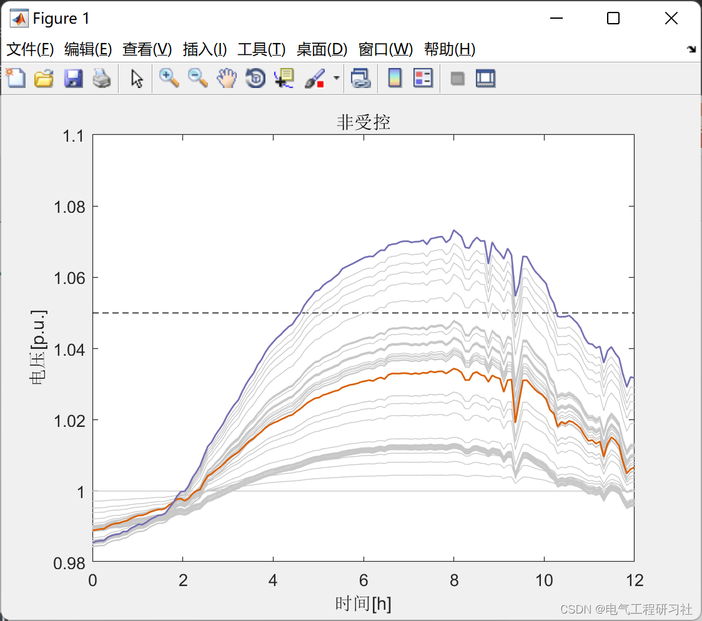
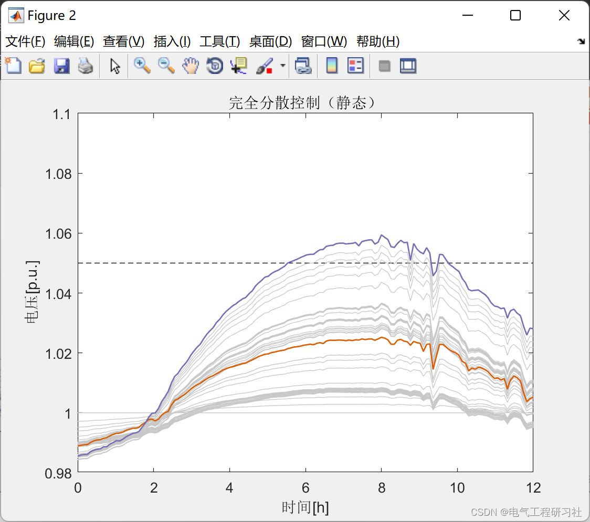
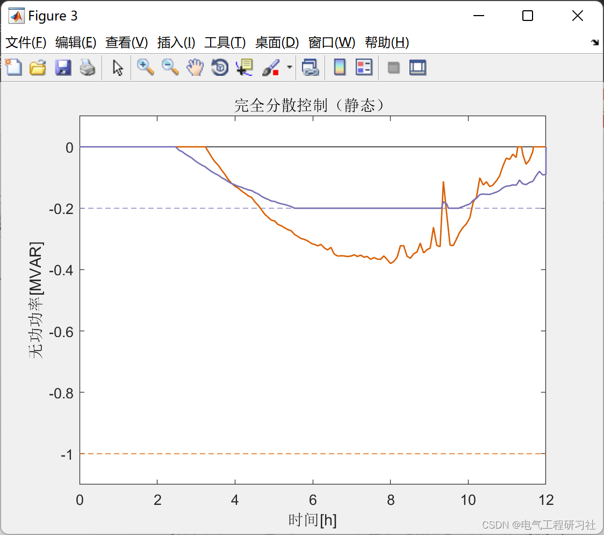
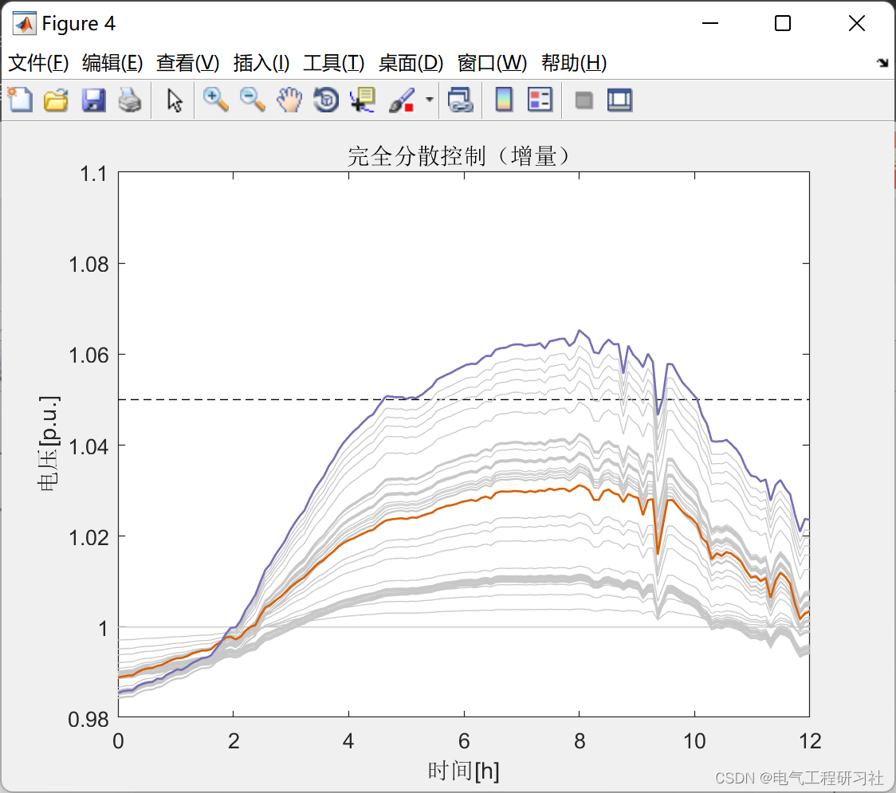
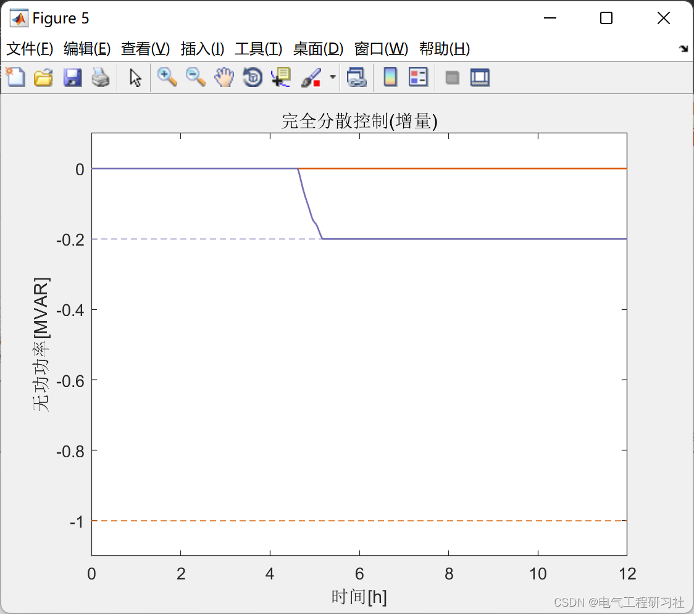
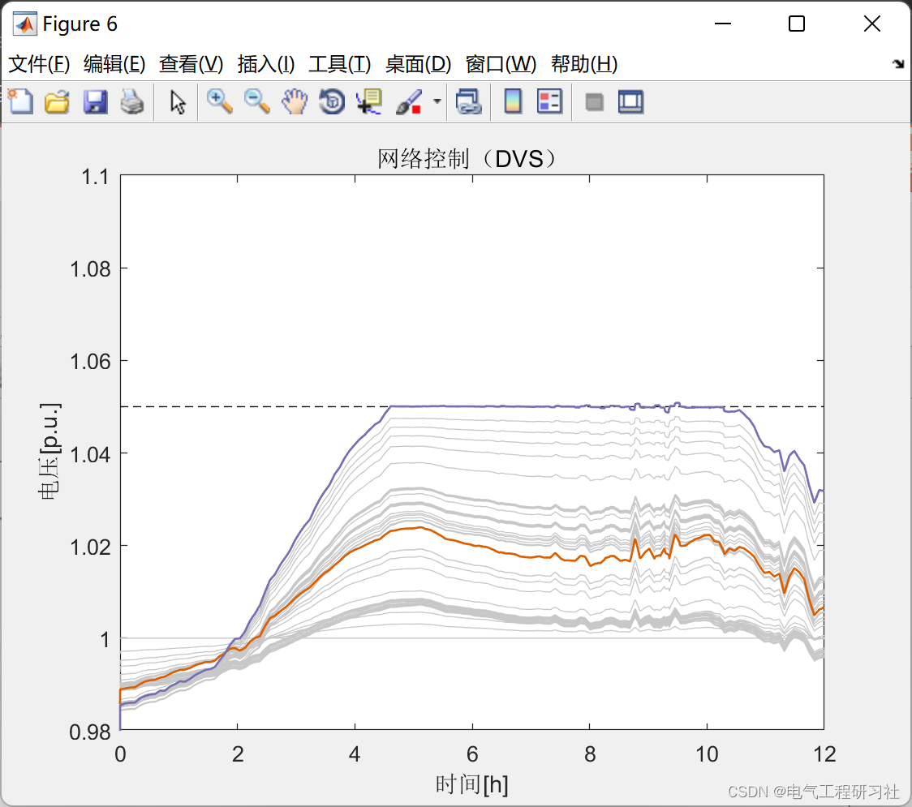
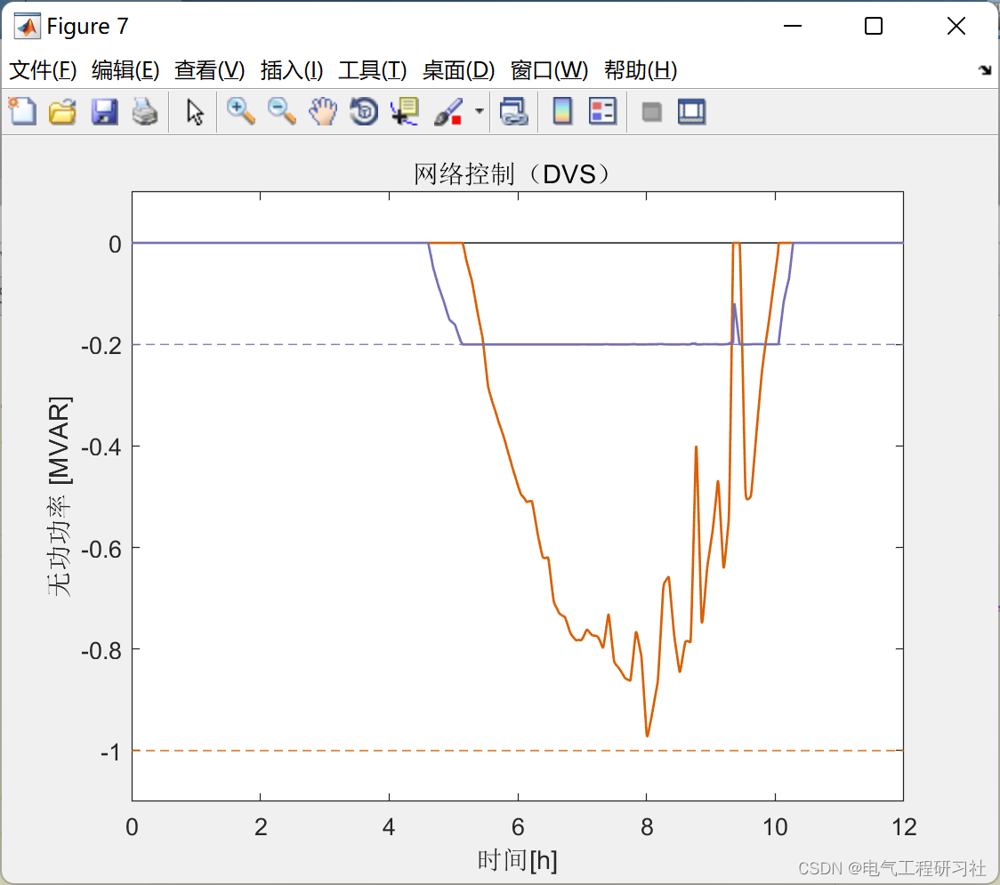
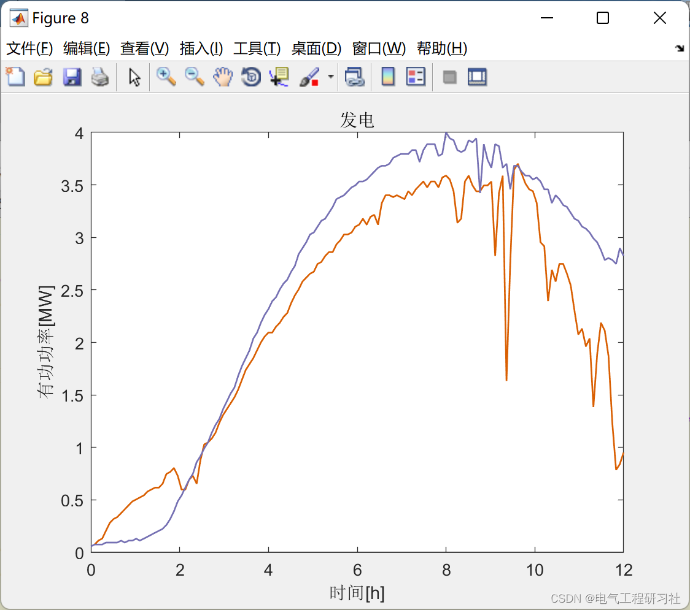
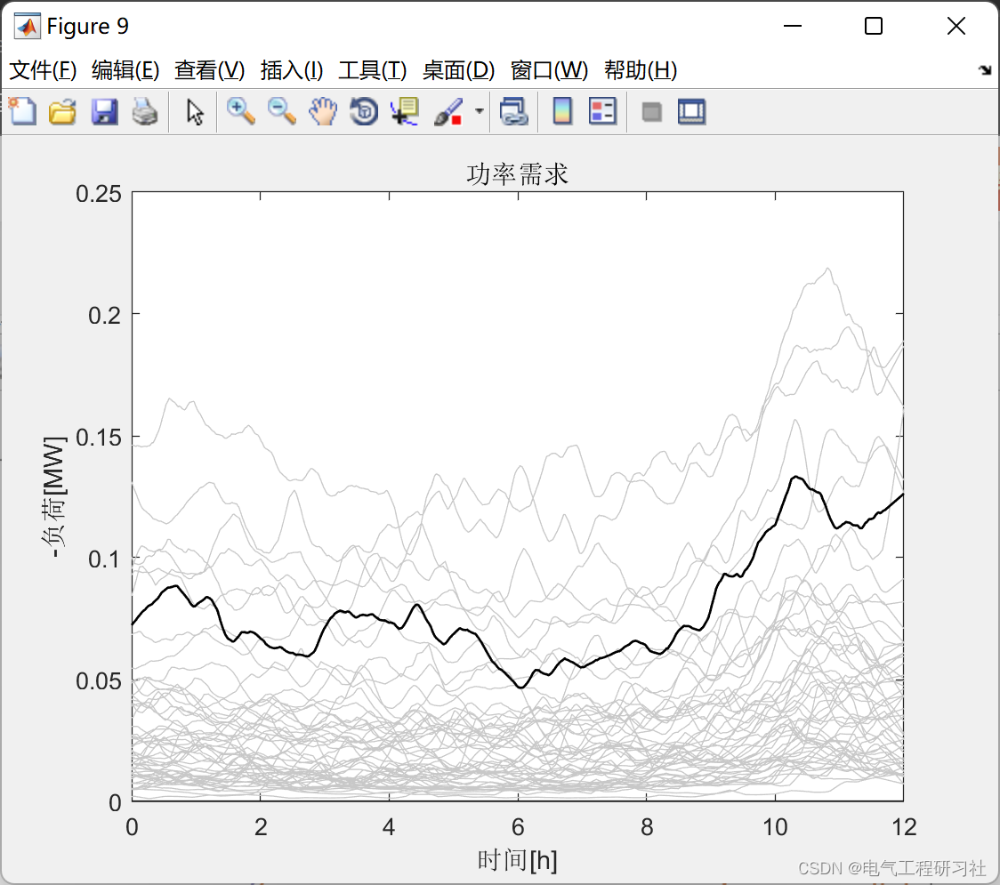

# Voltage Regulation and Communication in Power Distribution Network (Matlab Code Implementation)

🎉🎉 Welcome to your arrival 🎉🎉
📚📚📚📋 Special Section: The Beauty of Power Systems and Algorithms👨‍💻👨‍💻👨‍💻
👨‍🎓Bloggers' extracurricular interests: Eastern and Western philosophies. To the reader:👨‍💻 Doing research. Involving a deep-seated ideological system. Requires researchers to be logically precise. Pursuing diligence and seriousness. But it can't just be about effort. Many times, leverage is more important than effort. Additionally, there should be innovative and inspirational points for looking up at the stars. When the philosopher asks you what science is in class, What is electricity? Do not think these issues are funny. Philosophy is the pursuit of ultimate questions. Search for those questions that are self-evident to children but you cannot answer. In this column, I document some philosophical musings and scientific notes when I have the time: research and philosophy.It is recommended that readers browse the catalog in order, to avoid being suddenly plunged into a dark labyrinth without knowing how to return. It may not reveal all the answers to you, but it can certainly raise a multitude of doubts within your mind, which might lead to a different landscape of sunsets with colorful hues. If it brings you a heavy rain in the spiritual world, then take this opportunity to wash away the dust from the "truth" that was previously stored there. Perhaps, after the rain subsides and clouds clear up, the sky and earth will become even more clear...🔎🔎🔎
📋📋📋This article is organized as follows: ⛳️⛳️⛳️Table of Contents: 1. Overview 2. Mathematical Model 3. Running Results 4. Matlab Code + Data + Documentation Explanation 5. Final Thoughts
1. Overview: The future distribution network is expected to support a large number of distributed microgrids, meeting the growing demands, such as those driven by the widespread adoption of electric vehicles. These grids are expected to exhibit congestion phenomena, which cannot be fully addressed by designing super-large networks based on worst-case analysis alone. For instance, the voltage distribution of these low and medium voltage networks will be affected by bidirectional active power flows, with overvoltage and undervoltage conditions becoming more frequent.
This article provides micro-generators with both sensory and computational capabilities, and leverages the flexibility of power electronic interfaces to inject (or withdraw) reactive power from the grid. With proper control, these devices can serve as sophisticated reactive power compensation networks for distribution networks, providing valuable auxiliary services, ultimately preventing renewable energy curtailment, facilitating widespread electric mobility, and delaying grid reinforcement.
​  
2 Mathematical Models - See the fourth section folder for detailed explanations of the article.
3. Running results
​ ​  
​  
​  
​  
​  
​  
​  
4. Matlab Code + Data + Documentation Explanation
%% Visualization\ndisp('Crew Visualization')\n\nclose all\n\ncolorone = [217,95,2]/255;\ncolortwo = [117,112,179]/255;\ncolorgrey = 200*[1,1,1]/255;\n\nfigure(1)\n    hold on\n    line([0 t(end)/60/60], [1 1], 'Color', 'black', 'LineStyle', '-')\n    line([0 t(end)/60/60], [params.VMAX params.VMAX], 'Color', 'black', 'LineStyle', '--')\n    plot(t/60/60,v_nocontrol, 'Color', colorgrey, 'LineWidth', 0.5)\n    plot(t/60/60,v_nocontrol(:,c(1)), 'Color', colorone, 'LineWidth', 1)\n    plot(t/60/60,v_nocontrol(:,c(2)), 'Color', colortwo, 'LineWidth', 1)\n    xlabel('Time[h]')\n    ylabel('Voltage[p.u.]')\n    ylim([0.98 1.1])\n    xlim([0 12])\n    box on\n    title('Non-controlled')\n    \n    \nfigure(2)\n    hold on\n    line([0 t(end)/60/60], [params.VMAX params.VMAX], 'Color', 'black', 'LineStyle', '--')\n    line([0 t(end)/60/60], [1 1], 'Color', 'black', 'LineStyle', '-')\n    plot(t/60/60,v_static, 'Color', colorgrey, 'LineWidth', 0.5)\n    plot(t/60/60,v_static(:,c(1)), 'Color', colorone, 'LineWidth', 1)\n    plot(t/60/60,v_static(:,c(2)), 'Color', colortwo, 'LineWidth', 1)\n    xlabel('Time[h]')\n    ylabel('Voltage[p.u.]')\n    ylim([0.98 1.1])\n    xlim([0 12])\n    box on\n    title('Fully Distributed Control (Static))')\n    \n    \nfigure(3)\n    hold on\n    line([0 t(end)/60/60], [params.QMIN(1) params.QMIN(1)], 'Color', colorone, 'LineStyle', '--')\n    line([0 t(end)/60/60], [params.QMIN(2) params.QMIN(2)], 'Color', colortwo, 'LineStyle', '--')\n    line([0 t(end)/60/60], [0 0], 'Color', 'black', 'LineStyle', '-')\n    plot(t/60/60,q_static(:,1), 'Color', colorone, 'LineWidth', 1)\n    plot(t/60/60,q_static(:,2), 'Color', colortwo, 'LineWidth', 1)\n    xlabel('Time[h]')\n    ylabel('Reactive power[MVAR]')\n    ylim([min(params.QMIN)-0.1 0.1])\n    xlim([0 12])\n    box on\n    title('Fully Distributed Control (Static))')\n    \n    \nfigure(4)\n    hold on\n    line([0 t(end)/60/60], [params.VMAX params.VMAX], 'Color', 'black', 'LineStyle', '--')\n    line([0 t(end)/60/60], [1 1], 'Color', 'black', 'LineStyle', '-')\n    plot(t/60/60,v_incremental, 'Color', colorgrey, 'LineWidth', 0.5)\n    plot(t/60/60,v_incremental(:,c(1)), 'Color', colorone, 'LineWidth', 1)\n    plot(t/60/60,v_incremental(:,c(2)), 'Color', colortwo, 'LineWidth', 1)\n    xlabel('Time[h]')\n    ylabel('Voltage[p.u.]')\n    ylim([0.98 1.1])\n    xlim([0 12])\n    box on\n    title('Fullly decentralized control (incremental))')\n    \n    \nfigure(5)\n    hold on\n    line([0 t(end)/60/60], [params.QMIN(1) params.QMIN(1)], 'Color', colorone, 'LineStyle', '--')\n    line([0 t(end)/60/60], [params.QMIN(2) params.QMIN(2)], 'Color', colortwo, 'LineStyle', '--')\n    line([0 t(end)/60/60], [0 0], 'Color', 'black', 'LineStyle', '-')\n    plot(t/60/60,q_incremental(:,1), 'Color', colorone, 'LineWidth', 1)\n    plot(t/60/60,q_incremental(:,2), 'Color', colortwo, 'LineWidth', 1)\n    xlabel('Time[h]')\n    ylabel('Reactive power[MVAR]')\n    ylim([min(params.QMIN)-0.1 0.1])\n    xlim([0 12])\n    box on\n    title('Fullly decentralized control(Incremental)')\n    \nfigure(6)\n    hold on\n    line([0 t(end)/60/60], [params.VMAX params.VMAX], 'Color', 'black', 'LineStyle', '--')\n    line([0 t(end)/60/60], [1 1], 'Color', 'black', 'LineStyle', '-')\n    plot(t/60/60,v_networked, 'Color', colorgrey, 'LineWidth', 0.5)\n    plot(t/60/60,v_networked(:,c(1)), 'Color', colorone, 'LineWidth', 1)\n    plot(t/60/60,v_networked(:,c(2)), 'Color', colortwo, 'LineWidth', 1)\n    xlabel('Time[h]')\n    ylabel('Voltage[p.u.]')\n    ylim([0.98 1.1])\n    xlim([0 12])\n    box on\n    title('Network control (DVS)')\n    \nfigure(7)\n    hold on\n    line([0 t(end)/60/60], [params.QMIN(1) params.QMIN(1)], 'Color', colorone, 'LineStyle', '--')\n    line([0 t(end)/60/60], [params.QMIN(2) params.QMIN(2)], 'Color', colortwo, 'LineStyle', '--')\n    line([0 t(end)/60/60], [0 0], 'Color', 'black', 'LineStyle', '-')\n    plot(t/60/60,q_networked(:,1), 'Color', colorone, 'LineWidth', 1)\n    plot(t/60/60,q_networked(:,2), 'Color', colortwo, 'LineWidth', 1)\n    xlabel('Time[h]')\n    ylabel('Reactive power [MVAR]')\n    ylim([min(params.QMIN)-0.1 0.1])\n    xlim([0 12])\n    box on\n    title('Network control (DVS)')\n    \nfigure(8)\n    hold on\n    line([0 t(end)/60/60], [0 0], 'Color', 'black', 'LineStyle', '-')\n    plot(t/60/60,pvproduction(:,1), 'Color', colorone, 'LineWidth', 1)\n    plot(t/60/60,pvproduction(:,2), 'Color', colortwo, 'LineWidth', 1)\n    xlabel('Time[h]')\n    ylabel('Active power[MW]')\n    xlim([0 12])\n    box on\n    title('Electricity generation')\n    \n    \nfigure(9)\n    hold on\n    line([0 t(end)/60/60], [0 0], 'Color', 'black', 'LineStyle', '-')\n    plot(t/60/60,p, 'Color', colorgrey)\n    plot(t/60/60,p(:,15), 'Color', 'black', 'LineWidth', 1)\n    xlabel('Time[h]')\n    ylabel('-Load[MW]')\n    xlim([0 12])\n    box on\n    title('Power requirements')\n   \n5 End of the text, theoretical references to online literatures, if there is any infringement, please contact the blogger to delete.。  

## Images

<!-- PAYMENT_BLOCK -->

## Get this dataset

- Payment link (Stripe): [Buy now](https://buy.stripe.com/3cs8yP7sY87d0vu9AB)
- Payment QR code: 

<!-- /PAYMENT_BLOCK -->
